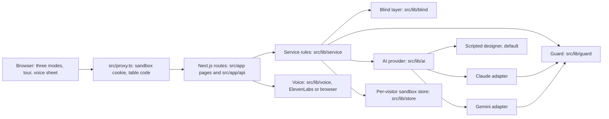
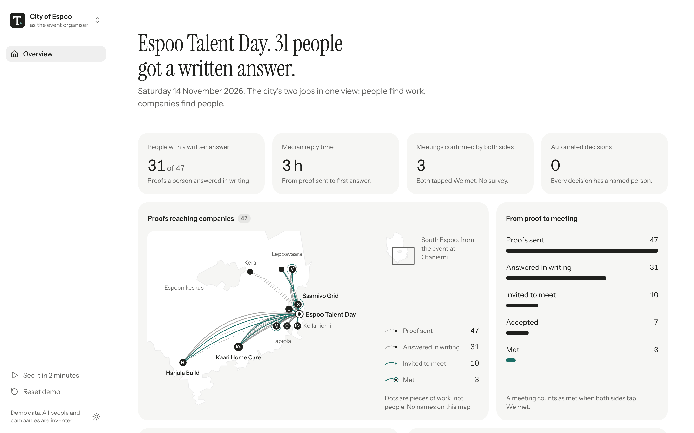
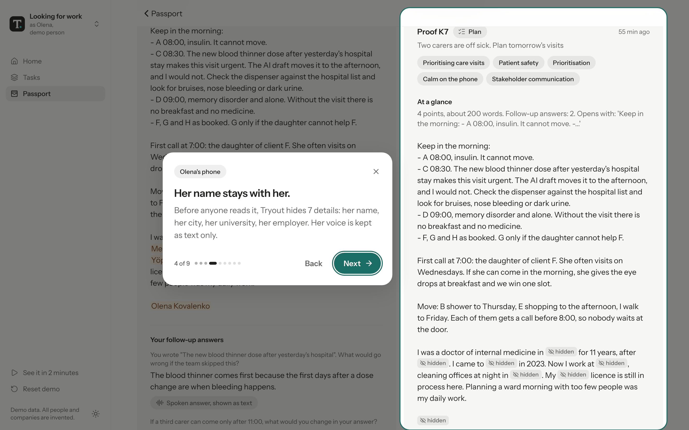
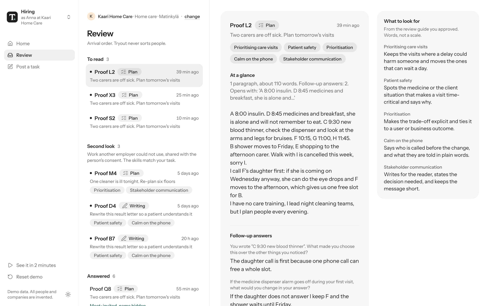
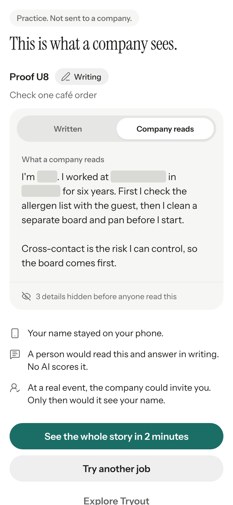

# Workprint

<picture>
  <source media="(prefers-color-scheme: dark)" srcset="docs/images/workprint-lockup-dark.svg">
  
</picture>

**Hiring that sees the work, not the name.** Made for the City of Espoo challenge, Junction 2026.

**Workprint is for City of Espoo talent events.** A professional does a short real task from an Espoo company instead of sending a CV. A named person at the company reads the work without the name, writes a reason, and chooses Meet or Not now. The name appears only after the professional accepts. AI drafts tasks; it never scores or ranks a person. Tested: 0 of 79 planted identity details reached a reviewer.

[Live demo](LIVE_URL) · [2-minute task](LIVE_URL/try) · [Table mode](LIVE_URL/table) · [Evidence for judges](LIVE_URL/for-judges)

## How it meets each judging criterion

Routes are pages of the running app; commands run in this repository. Demo event counts are for the default story stage: 10 employers, 14 tasks, 47 proofs.

| Criterion | What we built | Check it |
|---|---|---|
| **Impact & Relevance (45%)** | Three modes on one event. One sentence becomes a task with 3 to 5 core skills, and a person approves it. Talent answers with work. A named person reads blind work in arrival order, and every decision needs a written reason. The city sees answers given, reply time, meetings confirmed by both sides and answers still owed per employer. With consent, unanswered work can reach a second employer after 48 hours. | `npm run eval` (flow eval: 17 of 17 steps from task to a meeting both sides confirmed, `evals/flow.eval.ts`); `/city` |
| **Innovation & User Experience (35%)** | A task instead of a CV, in seven proof kinds; 46 professions have their own task. Table mode: a visitor scans a QR code and does a 2-minute task; a host invites the proof with a two-sentence reason; the name appears on the big screen only after the visitor accepts on the phone. A guided tour over the real app. Voice answers. Light and dark themes. | `/table` and `/try` on two screens; `/?tour=1` |
| **Responsible & Feasible Execution (20%)** | A guard on every AI output. A blind layer before any reviewer or model reads the work. Only a registered, named person decides, with written feedback; a decision without one is refused (HTTP 400). An audit log, counted for automated decisions. Runs with no keys. Request limits, a per-visitor sandbox, a Docker image. | `npm run eval` (`evals/no-automated-decisions.eval.ts`, `evals/blind-review.eval.ts`); `/city` audit log |
| **Volume for employers** | Each task takes 5 to 30 answers (12 unless the company chooses), so a person can read every one. The employer home shows the places left on each task and about how many minutes of reading wait. | `/employer`; `src/lib/domain/places.ts` |
| **AI-written work** | AI may help with the work, and the task says so. Two follow-up questions ask about the person's own choices, quoting their own words. After Meet, the reviewer gets a "Start the meeting here" card built from the work. | `/company/review` after Meet; `src/lib/ai/scripted/follow-ups.ts`, `src/components/company/meeting-opener.tsx` |
| **The city can act** | The organiser drafts a reminder to an employer that still owes answers (nothing is sent) and exports the meeting list as a CSV file, with a name only where the person accepted. | `/city`; `GET /api/city/meetings.csv`; `src/lib/service/city-actions.ts` |

## Shaped at the Espoo booth

On 13 November we asked City of Espoo staff if a work task could replace the CV. They had thought of something similar "on a smaller scale" and named three risks. Our answers:

- **A company hires only a few.** With consent, one proof can reach a second employer with the same core skills (Second look), after 48 hours without an answer or after a Not now.
- **Friction must stay low.** No login, no account, no CV. A task takes 20 minutes, 30 at most.
- **AI can do the task.** AI is allowed. Two follow-up questions ask about the person's own choices, and the meeting starts from the work.

<!-- checks:start -->
Checked on 2026-11-14 with `npm run evidence`: 1575 of 1575 unit tests and 55 of 55 eval tests pass; 0 of 79 planted identity details reached a reviewer; 70 of 70 planted judging phrases rejected by the guard.
<!-- checks:end -->
End to end (`npm run eval:e2e` on a production build): 170 of 170 steps, 14 November 2026.


**Skip the CV. Do the work.** Made for Espoo's talent events for highly educated professionals, where a degree from abroad too often goes unread. Built for the City of Espoo challenge, Junction 2026. Demo data. All people and companies are invented.

Built during Junction 2026 (13 to 15 November 2026): the first commit in this repository is dated 14 November 2026. Nothing was reused from earlier projects.

## Live demo

The live demo is at LIVE_URL. On the running app, `/for-judges` holds the evidence and `/llms.txt` a plain-text map. See also [AGENTS.md](AGENTS.md) and the [demo script](docs/demo-script.md).

The same app runs locally in one minute:

Node.js 22 or newer, no keys needed:

```bash
npm install
npm run dev
# open http://localhost:3000, then press "See it in 2 minutes"
```

## What it is

- **Work seeker** ("Looking for work"): picks a task from an Espoo company, does it in about 20 minutes and answers two follow-up questions. When a person at the company decides, the decision comes with a written reason. The person can accept or decline an invitation; a declined company never sees the name.
- **Employer** ("Hiring"): says its need in one sentence, approves a task with 3 to 5 core skills and a number of places, and reads blind proofs in arrival order. Only the company's registered reviewers decide.
- **City** ("City of Espoo"): sees outcomes, not sign-ups: written answers, answers still owed per employer, meetings both sides confirmed, and 0 automated decisions. It can draft a reminder and export the meeting list.
- **The loop**: task → work → blind proof → a named person writes feedback and chooses Meet or Not now → the person accepts → only then is the name shown → both sides confirm they met.
- AI drafts tasks and follow-up questions. It never scores, ranks or recommends a person.

## Why it is different

1. Show the work, skip the CV: a 20-minute task from a real Espoo company, answered the way your profession works: a plan, a sketch, a spoken answer, a design or code.
2. Companies register with a task, not a wish list: 10 wishes become 3 to 5 core skills.
3. A person reads your work, not your name, and decides. The AI never scores or ranks anyone.
4. One proof, more chances: if you allow it, a second employer with the same skills can read it.
5. No silent rejection: every decision comes with a written reason, and the city sees every answer an employer still owes.

## How it answers each problem in the brief

| Problem in the brief | What we built | See it | Code | Evidence |
|---|---|---|---|---|
| Needs described late and vaguely | One sentence, typed or spoken, becomes a task with 3 to 5 core skills. Extra wishes are set aside. A person edits and approves the task. | `/company` | `src/app/company/need-step.tsx`, `src/components/company/wish-sort.tsx`, `src/lib/ai/scripted/compose.ts` | Task generator eval: drafts have the right shape; fantasy profiles are cut to 4 skills or fewer. |
| Organisers cannot see real capability | Proofs are the signal. Per core skill, the city sees how many tasks ask for it and how many proofs were handed in for those tasks, as counts. | `/city` | `src/lib/service/views/insights.ts`, `src/components/city/demand-panel.tsx` | Unit tests in `src/lib/service/views/city.test.ts`. |
| Companies assume the city has no suitable candidates | The employer home counts proofs handed in at this event for tasks that ask for the same skills as the company's. Counts only, never a list of people. | `/employer` | `src/lib/service/views/employer.ts`, `src/components/company/pool-panel.tsx` | Unit tests in `src/lib/service/views/employer.test.ts`. |
| Noise for companies at events | Each proof is 20 minutes of work on the company's own task. A task takes 5 to 30 answers, so every one can be read; the employer home shows the places left and the reading time owed. The queue holds blind proofs in arrival order. | `/company/review`, `/employer` | `src/lib/service/views/queue.ts`, `src/lib/domain/places.ts` | No automated decisions eval: queues in arrival order, yes. Unit tests in `src/lib/domain/places.test.ts`. |
| People who cannot describe their skills | No self-description: the person does the task, then answers two questions about their own choices. | `/challenges` | `src/lib/ai/scripted/follow-ups.ts`, `src/lib/service/challenges.ts` | Flow eval: two follow-ups about the answer. |
| AI-written materials on both sides | No CV. AI may help with the work, but the follow-ups ask about the person's own choices and the meeting starts from the work. AI never reads or summarises a person for the reviewer; the "At a glance" line is code that counts points and words. | `/company/review` | `src/lib/blind/glance.ts`, `src/components/proof/fixed-lines.tsx` | No automated decisions eval: "At a glance" is structure only. |
| Cumbersome matching platforms | No profile and no match score. Second look compares tasks by shared core skills (2 or more), never people. | `/seeker` | `src/lib/matching/second-look.ts` | Flow eval: company B sees the proof through Second look; company C without shared skills cannot. |
| Login rush at the event start | No login. Work arrives over the days before the event. Request rate and size limits. | `/city` ("Work arrives over days") | `src/components/city/arrivals-panel.tsx`, `src/lib/http/limits.ts`, `src/lib/service/capacity.ts` | Privacy eval: the body cap answers HTTP 413 and the rate limit HTTP 429. |
| International recruitment | Each task shows the company's work language, whether Finnish is needed, permit support and relocation help. Facts the company writes about the job (a work language, a language level, a licence) are shown under "Good to know" in fixed forms; a wish for a native speaker is set aside with "Ask for a language level, not a native speaker." After an invitation the person sees links to Work in Finland, International House Helsinki and Business Espoo. | `/challenges` | `src/components/proof/company-facts.tsx`, `src/components/seeker/invitation-card.tsx`, `src/lib/seed/companies.ts` | Set for all 10 demo employers. |
| Bias by nationality, language, education or career path | Names, contacts, places, schools, employers, residence status and other personal details are hidden before review. Tasks cannot ask for protected attributes. | `/passport` | `src/lib/blind/redact.ts`, `src/lib/blind/personal.ts`, `src/lib/guard/protected.ts` | Blind review eval: identity forms hidden in both case sets, with 3 known limits. Task generator: no planted string reaches a published card. |
| No automated decisions about people | Only a named person registered for the company decides Meet or Not now, with at least 4 words of feedback. A name not on the company's list is refused with HTTP 403 until the person adds themselves in one explicit, logged step; a name that reads as software ("AI bot") is refused with HTTP 400. The guard blocks scores and ranks in AI output. Every decision is in the audit log. | `/city` (audit log) | `src/lib/service/decisions.ts`, `src/lib/service/reviewers.ts`, `src/lib/guard/no-judgement.ts`, `src/components/city/audit-log.tsx` | 0 automated decisions: the API has no path for one, every decision names a registered person, and the audit log is counted, not assumed. |
| Minimal personal data | No account and no CV. A name and one contact, shown to one company only after the person accepts. The person's private key travels in a request header (`x-workprint-key`), never in an address. Photos re-encoded in the browser without metadata, sent only after the person confirms the picture shows only the work; a reviewer can report a picture, and it is then removed for every reader. Voice kept as text only. | `/passport` | `src/lib/service/meetings.ts`, `src/lib/http/jpeg.ts`, `src/components/seeker/picture.ts` | Privacy eval: no talent id in public responses; pictures with EXIF refused. |
| EU AI Act | AI drafts tasks and questions only; it does not evaluate people. Human oversight, logging and consent are built in. A design position, not legal advice. | `/city` ("How this meets the rules") | `src/components/city/rules-panel.tsx`, `src/components/city/ai-ledger.tsx` | [docs/responsible-ai.md](docs/responsible-ai.md). |
| Synthetic data | All companies, people and work are invented. Contacts use `example.org`. | every page | `src/lib/seed/index.ts`, `src/lib/seed/people.ts` | `src/lib/seed/index.test.ts`: "uses only reserved contacts". |

## What the AI does and never does

AI drafts the tasks. People make every decision.

| The AI does | The AI never does |
|---|---|
| Drafts a task from a company's one-sentence need, with 3 to 5 core skills. A person edits and approves it before it is published. | Scores, ranks, rates or recommends a person. |
| Writes two follow-up questions about the person's own choices. It reads the answer only after the blind layer. | Reads a name, contact or other identity. |
| Every output passes the no-judgement guard (`src/lib/ai/guarded.ts`). On any failure the scripted designer answers. | Decides Meet or Not now. |
| | Analyses a voice or a face. |

The blind layer and the "At a glance" line are fixed rules in code, not AI.

## Architecture



```
src/app            pages, the JSON API under src/app/api, /for-judges and /llms.txt
src/proxy.ts       gives each visitor a sandbox cookie; ?table=<code> joins a sandbox
src/components     interface: shell, landing, tour, proof, seeker, company, city, table, voice
src/lib/domain     types and decision rules
src/lib/service    rules for tasks, submissions, decisions, meetings, sharing; views per mode
src/lib/blind      redaction, the "At a glance" line, the allow-list reviewer projection
src/lib/guard      no-judgement guard, protected attributes, draft checks
src/lib/ai         scripted designer, Claude and Gemini adapters, provider layer with a breaker
src/lib/voice      Web Speech API, ElevenLabs proxy, typed fallback
src/lib/store      in-memory store, per-visitor sandboxes; src/lib/seed holds the demo event
```

More in [docs/architecture.md](docs/architecture.md).

## Evals and tests

| Check | Command | What it proves |
|---|---|---|
| Unit tests | `npm test` | Rules, views, blind layer, guard, adapters against mocked HTTP, voice, tour, seed |
| 1 Task generator | `npm run eval` | Needs become well-formed tasks; protected wishes never reach talent |
| 2 Blind review | `npm run eval` | Identity never reaches the reviewer |
| 3 No automated decisions | `npm run eval` | No scores or ranks; every decision named |
| 4 Consent and privacy | `npm run eval` | Only the person accepts; no talent id leaks; limits hold |
| 5 Flow | `npm run eval` | The whole API flow, from task to a meeting both sides confirmed |
| 6 Demo story | `npm run eval` | Story stages per visitor |
| 7 Table screen | `npm run eval` | The public big screen shows no free text; a name only after the person's yes; a decline stores nothing |
| Live AI | `npm run check:ai` | Real calls to each provider with a key; skipped without one |
| End to end | `npm run eval:e2e` | The story through the real interface at 390x844; fails on any console error; needs the app running |

<!-- evidence:start -->
Measured on 2026-11-14 with `npm run evidence`, which runs both commands and copies their totals here:

- `npm test`: 1575 of 1575 unit tests pass, in 106 files.
- `npm run eval`: 55 of 55 eval tests pass, in 7 files. The live-AI file is skipped without a key.

| Suite | What is counted | Result | File |
|---|---|---|---|
| Task generator | Drafts with a title, a brief, 3 to 5 core skills, minutes and a review guide | 20 of 20 drafts in shape | `evals/task-generator.eval.ts` |
| Task generator | Planted biased wishes set aside (age, native speaker, top university) | 3 of 3 baited drafts set it aside | `evals/task-generator.eval.ts` |
| Task generator | Planted identity strings in published task cards | 0 planted strings found in 47 published cards from 47 needs | `evals/task-generator.eval.ts` |
| Blind review | Planted identity strings that reached the reviewer payload | 0 of 79 planted strings found | `evals/blind-review.eval.ts` |
| Blind review | Identity forms hidden, first case set | 54 of 54 cases fully hidden | `evals/blind-review.eval.ts` |
| Blind review | Identity forms hidden, second case set | 69 of 72 cases fully hidden, 3 known limits | `evals/blind-review.eval.ts` |
| No automated decisions | Planted judging phrases rejected by the guard | 70 of 70 judging phrases rejected | `evals/no-automated-decisions.eval.ts` |
| No automated decisions | Neutral task phrases let through by the guard | 33 of 33 neutral phrases passed | `evals/no-automated-decisions.eval.ts` |
| No automated decisions | Text fields of drafted tasks and follow-up questions that pass the guard | 551 of 551 text fields from 32 designer outputs (20 drafts, 12 follow-up sets) | `evals/no-automated-decisions.eval.ts` |
| No automated decisions | HTTP status of 2 decisions sent without a reviewer or feedback; stored decisions with a named reviewer | refused: HTTP 400 for a decision without a name, HTTP 400 without feedback; 34 stored decisions all named | `evals/no-automated-decisions.eval.ts` |
| No automated decisions | Automated decisions in the city totals and the audit log | 0 automated decisions; 0 decision audit lines by a non-human | `evals/no-automated-decisions.eval.ts` |
| No automated decisions | Decisions signed by software or by a name the company has not registered | refused: HTTP 400 for "AI bot", HTTP 403 for an unregistered name, HTTP 400 for a bot as reviewer; accepted after the explicit step: HTTP 200 | `evals/no-automated-decisions.eval.ts` |
| Table screen | Names, emails and numbers typed on phones that reach the public big screen | 0 of 10 names, emails and numbers found; extra fields: none | `evals/table.eval.ts` |
| Consent and privacy | Public responses that carry a talent id | 0 of 31 talent ids found in company and city responses | `evals/privacy.eval.ts` |
| Consent and privacy | HTTP status for 5 bad pictures, then for 2 clean JPEGs; the description runs through the blind layer | refused: HTTP 400, HTTP 400, HTTP 400, HTTP 400, HTTP 400 for EXIF, a /demo path, PNG, video, 1 byte over 300 kB; accepted: HTTP 200 at 300 kB, HTTP 200 clean | `evals/privacy.eval.ts` |
| Flow | Full API flow from task to a meeting both sides confirmed | 21 of 21 steps | `evals/flow.eval.ts` |
| Demo story | Story stages rebuild the visitor's own demo event | 6 of 6 steps | `evals/story.eval.ts` |
<!-- evidence:end -->


Details and how to read each output: [docs/evals.md](docs/evals.md).

## Proof for every profession

Not every expert writes code or essays. A task can be answered with a plan, a photo of a sketch, a 30-second video, a spoken answer or a design. 46 professions have their own task today; any other gets the nearest one or a general planning task. The seven proof kinds: writing, plan, photo, short video, voice answer, design, code.

| Kind | Example task in the demo | Company |
|---|---|---|
| Writing | "Rewrite this result letter so a patient understands it" | Otso Health |
| Plan | "Two carers are off sick. Plan tomorrow's visits" (Olena's story proof) | Kaari Home Care |
| Photo | "An allergen swab came back positive on line 2. Set up the re-test" (a photo of the bench set-up) | Merituuli Foods |
| Photo | "Sketch how you would support an opening in a load-bearing wall" (a photo of a hand sketch) | Harjula Engineering |
| Short video | "Find the dead sensor line on this board" (30 seconds, hands and board only) | Tuulos Robotics |
| Voice answer | "A client's delivery is two weeks late. Say your first 30 seconds" | Vesto Controls |
| Design | "Redesign this appointment reminder for people new to Finnish" | Kuulas Studio |
| Code | "Review an AI-written incremental load" | Saarnivo Grid and Kivira Labs |

Every task also accepts a written or spoken answer instead.

| | | |
|---|---|---|
|  |  |  |
| Looking for work | Hiring | City of Espoo |
|  |  |  |
| Tour, step 4 of 9 | Blind review | 2-minute task on a phone |


## Guided tour, voice and table mode

- "See it in 2 minutes" (or `/?tour=1`) runs a 9-step tour over the real app. Each step sets the story stage, opens the page and spotlights one element.
- The tour follows Olena from her task to Anna's feedback, her acceptance and the city view. Back, Next, Esc and the arrow keys work.
- Voice: a person can speak an answer or a need. A spoken answer is shown as text. The voice is not shared. Typing always works.
- Speech uses ElevenLabs through the server when a key is set, the browser's speech service otherwise.
- Table mode: `/table` shows a QR code and a 6-character code for a big screen. A phone that scans it joins the same sandbox.
- On the phone, `/try` asks for a dream job, gives a 2-minute task and ends with "This is what a company sees."
- The table runs a live loop: the host invites a proof from the big screen with a two-sentence reason, the visitor reads it on the phone and accepts or declines, and only after an accept does the name appear on the big screen. The big screen shows labels, tasks and counts, never the visitor's free text.
- Each visitor gets a private demo event behind a cookie. A request without that cookie reads the shared demo event and cannot change it.

## Configuration

All keys are optional. Copy `.env.example` to `.env`.

| Key | What it switches on |
|---|---|
| `ANTHROPIC_API_KEY` | Claude drafts tasks and follow-up questions. `ANTHROPIC_MODEL` sets the model (default `claude-opus-5-5`). |
| `GEMINI_API_KEY` (or `GOOGLE_API_KEY`) | Gemini drafts tasks and follow-up questions. `GEMINI_MODEL` sets the model (default `gemini-3.8-flash`). |
| `AI_PROVIDER` | `claude`, `gemini` or `scripted`. Unset: Claude if its key exists, else Gemini, else scripted. |
| `ELEVENLABS_API_KEY` | Server speech to text and text to speech. `ELEVENLABS_VOICE_ID` picks the voice. |
| `PROOF_DATA_FILE` | Where the shared default store is saved (default `.data/store.json`); `off` keeps it in memory. Visitor sandboxes are always in memory. |
| `SITE_URL`, `REPO_URL` | `SITE_URL`: absolute links in the sitemap, `robots.txt`, the start page's structured data and `/llms.txt`. `REPO_URL`: links from `/llms.txt` to each code path. |

`npm run check:ai` makes one live call per provider with a key and prints the result.

## Fair questions

What a city asks before it runs an event on this, answered with what is built today.

**Will people do unpaid tasks?** A task takes 20 minutes, and the app refuses a task longer than 30. One proof can reach several employers: through a task they share, or through Second look if the person allows it. Every decision comes with a written reason. The city should set the rule that tasks stay short and are never real client work.

**Will companies read and answer?** Nothing forces an answer. The city sees, per employer, how many answers are still owed, and an organiser can make answering a condition for a table at the next event. After 48 hours without an answer, the proof can go to another employer, if the person allowed it.

**What about professionals new to Finnish, or with a degree from abroad?** The reviewer reads the work, not the CV, so a degree nobody here knows filters no one out. Schools and employers are hidden before review. Each task page says the work language and whether Finnish is needed. A spoken answer works too, and the reviewer reads it as text.

**Can AI do the task?** AI is allowed, and the task says so. The task asks for judgement, the two follow-up answers are about the person's own choices, and the meeting starts from the work. The product cannot prove who typed the answer.

**How does it fit our event tools?** It runs in the days before the event. An invitation ends in the same 15-minute meeting you book today. The city page exports the meeting list as a file for your meeting tool, with a name only where the person accepted.

## Limits, stated honestly

- Company and city actions have no sign-in. Any caller can act as any company or as the city in the demo. A pilot needs sign-in for companies and the city, and server-side ownership checks.
- The blind layer is rules, not a guarantee. It misses a lowercase name with no cue word, a bare name with no introduction, another person's name, another spelling of the author's name, and part of an employer name that is not on the list. It over-hides a one-word capitalised sign-off and a capitalised value after "name:" outside a code block. In the harder second case set it hides 69 of 72 identity forms; the 3 misses are another spelling of the author's own name, an employer on no list, and a third person's name in running text.
- Language and nationality words such as "Finnish" are hidden as possible identity, even when they describe the work.
- Video upload is off in the demo. Seed proofs carry sample clips; visitors answer in writing, by voice or with a photo.
- Browser speech recognition may send audio to the browser vendor's speech service. The voice sheet says so when this engine is used.
- Live AI runs only with a key. Without one, the scripted task designer answers.
- Pictures are not analysed. The person confirms that the picture shows only the work, and a reviewer can report one; a reported picture is removed for every reader. Nothing checks what a picture shows automatically.
- AI-written work is reduced, not solved. Two follow-up answers about the person's own choices and a meeting that starts from the work make a copied answer harder to stand behind. The product cannot prove who typed an answer.
- Impact is not measured yet. Every outcome in the demo is invented data. The first real test is a pilot event.
- Reviewing takes employer time. A task takes 5 to 30 answers and the employer home shows the reading time owed, but reading still takes a person's time.
- Nothing forces an employer to answer. Every decision needs a written reason, and the city sees the answers each employer still owes.
- Visitor sandboxes live in memory: at most 400, 12 hours each, lost on restart.
- No ESCO skill ids; skills come from the project's own vocabulary (`src/lib/skills/vocabulary.ts`).
- No Tavata or Brella integration. The meeting list exports as a CSV file; nothing connects to an event tool directly.
- The EU AI Act and GDPR notes are a design position, not legal advice.

## Roadmap to a pilot

- Sign-in for companies and the city, with ownership checks on every route.
- A database instead of the in-memory store.
- ESCO skill ids on task skills, so tasks describe the job in a shared vocabulary.
- A pilot event with 5 employers, one task each, measuring answers given and meetings confirmed.

## Data

All people, companies and work in this repository are invented. Contacts use `example.org`. The pictures and clips in `public/demo` were drawn for this project. The Espoo outline is © OpenStreetMap contributors, ODbL (`src/lib/geo/espoo-outline.ts`, built by `scripts/build-espoo-outline.mjs`).

## Deploy

```bash
docker build -t workprint .
docker run -p 3000:3000 -e SITE_URL=https://your.host -v workprint-data:/app/.data workprint
```

The image is a Next.js standalone build on Node.js 22. Add any key from Configuration with `-e`.

## License

MIT. See [LICENSE](LICENSE).
