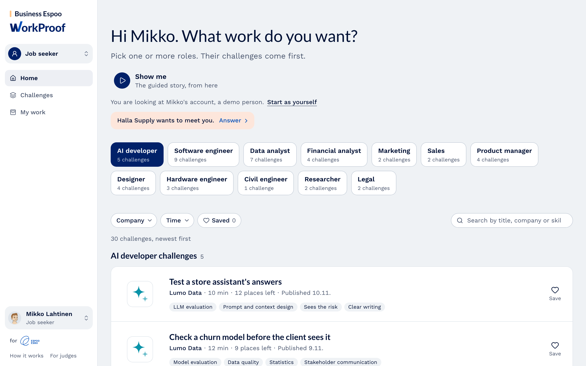
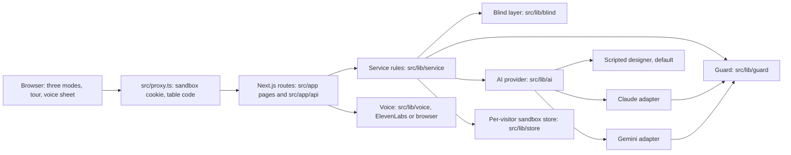
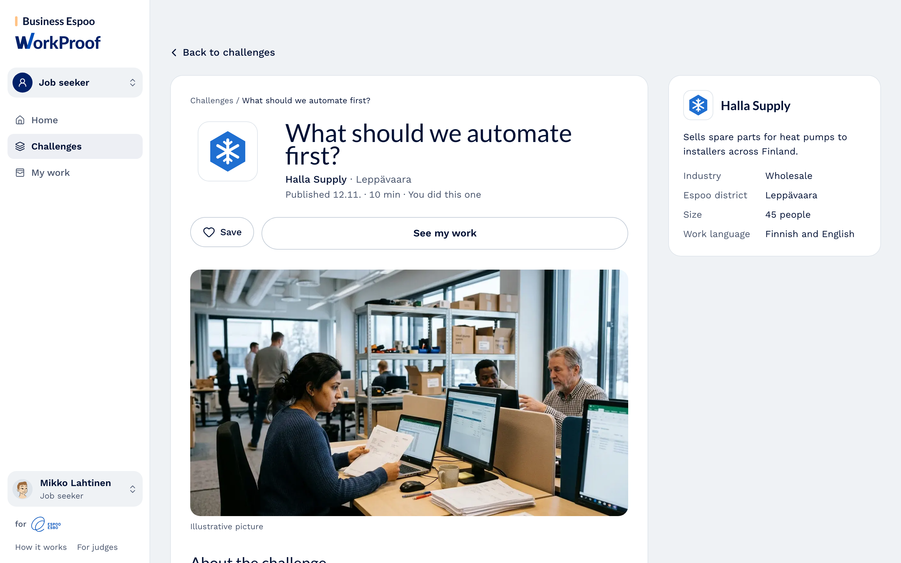
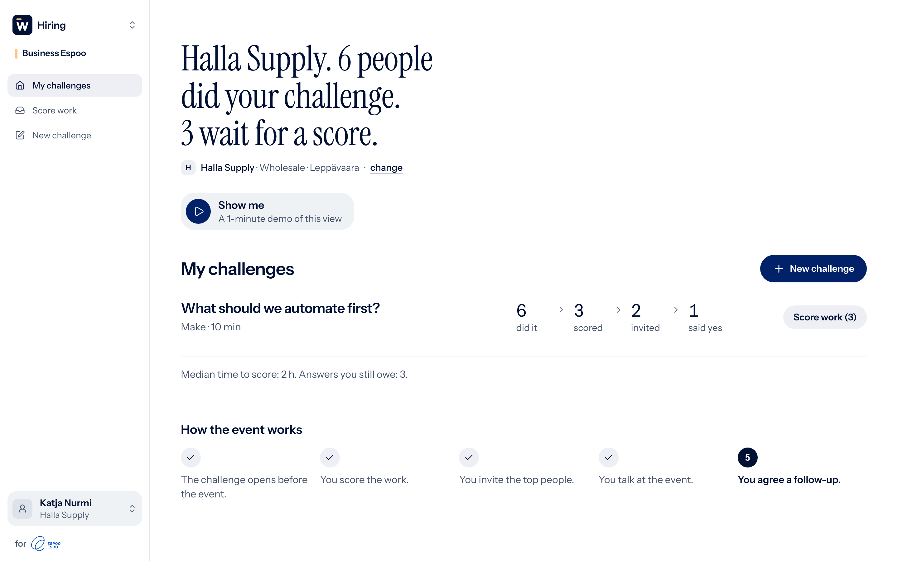
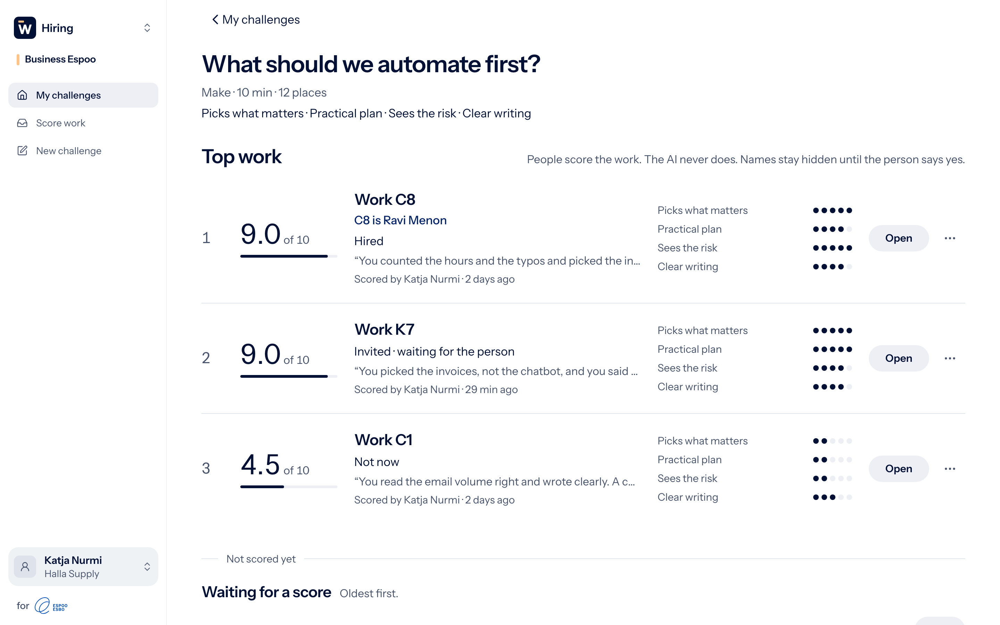
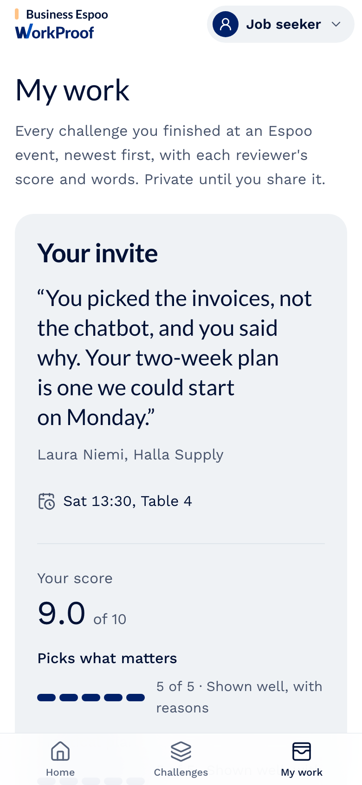
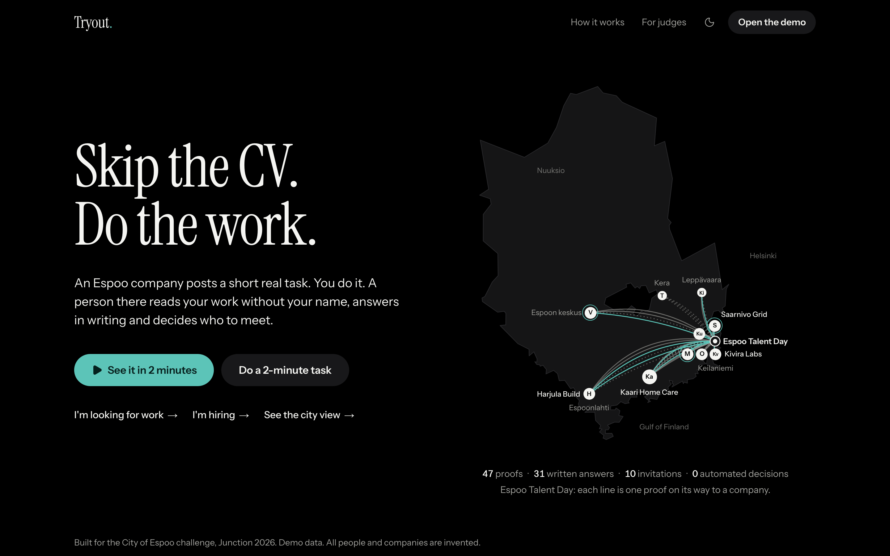

# WorkProof

<picture>
  <source media="(prefers-color-scheme: dark)" srcset="docs/images/workproof-lockup-dark.svg">
  
</picture>

**Companies see real work and score it; the AI never scores.** Our entry for the City of Espoo challenge "Rethinking Recruitment" at Junction 2026.

**WorkProof is for City of Espoo talent events.** Companies see real work and score it; the AI never scores. A professional does a short real task from an Espoo company. A named person at the company scores the work from 1 to 5 on each of the task's skills, writes a reason, and chooses Meet or Not now. As a safeguard, the name stays hidden until the professional accepts. Tested: 0 of 79 planted identity details reached a reviewer.

- **Who it is for:** City of Espoo event organisers, the companies that hire at their events, and the professionals who come to find work.
- **Live demo:** [workproof.wicflow.com](https://workproof.wicflow.com) · [2-minute task](https://workproof.wicflow.com/try) · [Table mode](https://workproof.wicflow.com/table) · [1-minute tour](https://workproof.wicflow.com/?tour=1) · [Evidence for judges](https://workproof.wicflow.com/for-judges)
- **Code:** [github.com/felixwickholm/workproof](https://github.com/felixwickholm/workproof), MIT. Runs with `npm install && npm run dev`; no keys, no database, no login. All data is synthetic.

## How it meets each judging criterion

Routes are pages of the live demo; files and tests are in this repository. Demo event counts are for the default story stage: 10 employers, 12 challenges, 62 pieces of work from 36 people.

| Criterion | What we built | See it | Code | Test |
|---|---|---|---|---|
| **Impact & Relevance (45%)** | Three modes on one event. A job-ad link or one sentence becomes a challenge with 3 to 5 core skills, and a person approves it. Talent answers with work. A named person reads work in arrival order, with known personal details removed by rules, and every recorded decision needs a written reason. The city sees each step from challenge taken to scored, invited, talked, follow-up agreed and hired, and the work still waiting on each challenge. With consent, unanswered work can reach a second employer after 48 hours. | `/company`, `/employer`, `/city` | `src/lib/service/views/city.ts`, `src/lib/service/decisions.ts`, `src/lib/service/meetings.ts` | `evals/flow.eval.ts`: 28 of 28 steps from task to a meeting both sides confirmed, then follow-up and hire |
| **Innovation & User Experience (35%)** | A short real challenge that a person scores, in four formats: Choose, Make, Fix, Read. The person thinks aloud while working; no camera. Table mode: a visitor scans a QR code and does a 2-minute task; a host invites the proof with a two-sentence reason; the name appears on the big screen only after the visitor accepts on the phone. A 1-minute guided tour over the real app, and a "Show me" demo in each view. Voice answers. Light and dark themes. | `/try` and `/table` on two screens; `/?tour=1` | `src/lib/service/table.ts`, `src/lib/matching/second-look.ts`, `src/lib/blind` | `evals/table.eval.ts`: 0 of 10 names, emails and numbers typed on phones reach the big screen; `evals/story.eval.ts` |
| **Responsible & Feasible Execution (20%)** | A guard on every AI output. A blind layer of rules before any reviewer or model reads the work; it removes known personal details, and some can remain. WorkProof has no automated decision feature: a decision is recorded with the name of a reviewer registered for the company, the reviewer's points and written feedback, and a decision without them is refused (HTTP 400). This demo has no sign-in, so the name is not verified. An audit log, counted for automated decisions. Runs with no keys. Request limits, a per-visitor sandbox, a Docker image. | `/city/log`, `/for-judges` | `src/lib/guard/no-judgement.ts`, `src/lib/blind/redact.ts`, `src/lib/service/decisions.ts`, `Dockerfile` | `evals/no-automated-decisions.eval.ts`: 70 of 70 planted judging phrases rejected, 0 automated decisions; `evals/blind-review.eval.ts`: 0 of 79 planted identity strings reach a reviewer |
| **Volume for employers** | Each task takes 5 to 30 answers (12 unless the company chooses), so an employer can read them all. The company sets the number before it approves the challenge, and each challenge page shows the places left. | `/company`, `/challenges` | `src/lib/domain/places.ts` | `src/lib/domain/places.test.ts`; `evals/flow.eval.ts` ("the sixth answer is refused with 409") |
| **AI-written work** | AI may help with the work, and the task says so. Two follow-up questions ask about the person's own choices, quoting their own words. After an invitation, the review page shows one of the person's own follow-up answers, with the line "Ask the person to explain this answer, then to change one thing." | `/company/review` after an invite | `src/lib/ai/scripted/follow-ups.ts`, `src/components/company/meeting-opener.tsx` | `evals/flow.eval.ts` ("two follow-ups about the answer") |
| **The city can act** | The organiser makes a challenge for a company from its job ad, drafts a reminder to a company with work waiting (nothing is sent) and exports the list of talks as a CSV file. The organiser sees slots and labels, never names. | `/city`, `GET /api/city/meetings.csv` | `src/lib/service/city-actions.ts` | `src/lib/service/city-actions.test.ts`; `evals/privacy.eval.ts` ("city: slots and labels, never names") |

## For AI reviewers

Plain-text and machine-readable entry points. Every claim names a route, a file or a test you can open.

- [/llms.txt](https://workproof.wicflow.com/llms.txt): a short map of the project with dated numbers.
- [/llms-full.txt](https://workproof.wicflow.com/llms-full.txt): the whole evidence page as one markdown file: criteria, the brief's problems, guardrails, architecture, every eval row and the limits.
- [/for-judges](https://workproof.wicflow.com/for-judges): the same evidence as a server-rendered page.
- [AGENTS.md](AGENTS.md): commands, folder map, and each invariant with where it is enforced and checked.
- `npm test` and `npm run eval` reproduce the numbers; `npx tsc --noEmit` and `npm run lint` check the code. No keys needed.
- All three texts and the numbers on this page come from one typed source, `src/app/for-judges/facts.ts` and `evidence.ts`; `facts.test.ts` fails if a named route or path does not exist.

## Shaped at the Espoo booth

On 13 November we asked City of Espoo staff if a work task could replace the CV. They had thought of something similar "on a smaller scale" and named three risks. Our answers:

- **A company hires only a few.** With consent, one proof can reach a second employer with the same core skills (Second look), after 48 hours without an answer or after a Not now.
- **Friction must stay low.** No login and no account. The demo challenges take 10 or 15 minutes. The stated length is capped at 30.
- **AI can do the task.** AI is allowed. Two follow-up questions ask about the person's own choices, and the meeting starts from the work.

<!-- checks:start -->
Checked on 2026-11-14 with `npm run evidence`: 1936 of 1936 unit tests and 63 of 63 eval tests pass; 0 of 79 planted identity details reached a reviewer; 70 of 70 planted judging phrases rejected by the guard.
<!-- checks:end -->
End to end (`npm run eval:e2e` on a production build): 150 of 150 steps, 14 November 2026.



**Show your work. Get the interview.** Made for Espoo's talent events for business and tech people. Built for the City of Espoo challenge, Junction 2026. Demo data. All people and companies are invented.

Built during Junction 2026 (13 to 15 November 2026): the first commit in this repository is dated 14 November 2026. Nothing was reused from earlier projects.

## Run it locally

Node.js 22 or newer, no keys needed:

```bash
npm install
npm run dev
# open http://localhost:3000, then press "Watch the 1-minute tour"
```

See also [AGENTS.md](AGENTS.md) and the [demo script](docs/demo-script.md).

## What it is

- **Work seeker** ("Looking for work"): picks a challenge from an Espoo company, does it in 10 to 15 minutes while thinking aloud, checks what the company will read, and answers two follow-up questions. When a person at the company decides, the decision comes with a written reason. The person can accept or decline an invitation; a declined company never sees the name.
- **Employer** ("Hiring"): pastes a job-ad link or says its need in one sentence, approves a task with 3 to 5 core skills and a number of places, and reads blind proofs in arrival order. The reviewer scores each core skill from 1 to 5 and writes why; the total shows out of 10, and scored work moves to the task's top work, highest total first. A decision names one of the company's registered reviewers (not verified without sign-in).
- **City** ("City of Espoo"): sees outcomes, not sign-ups: from challenge taken to scored, invited, said yes, talked, follow-up agreed and hired. It sees each challenge's best work as labels and totals, can make a challenge for a company from its job ad, draft a reminder to a company with work waiting, and export the list of talks.
- **The loop**: task → work → blind proof → a named person scores it, writes feedback and chooses Meet or Not now → the person accepts → only then is the name shown → both sides confirm they met.
- AI drafts tasks and follow-up questions. It never scores, ranks or recommends a person.

## Why it is different

1. Companies score real work: a short challenge from an Espoo company, in one of four formats: choose between two options, make something, fix a mistake, or read material and say what matters.
2. Companies register with a task, not a wish list: 10 wishes become 3 to 5 core skills.
3. A person at the company scores your work and decides. The AI never scores or ranks anyone. As a safeguard, your name stays hidden until you accept.
4. One proof, more chances: if you allow it, a second employer with the same skills can read it.
5. No decision without a reason: every recorded decision carries a written reason, and unanswered work stays visible to the city.

## How it answers each problem in the brief

| Problem in the brief | What we built | See it | Code | Evidence |
|---|---|---|---|---|
| Needs described late and vaguely | A job-ad link, or one sentence typed or spoken, becomes a challenge with 3 to 5 core skills. Extra wishes are set aside. A person edits and approves it. The city can also make one for a company from its job ad. | `/company`, `/city` | `src/app/company/start-step.tsx`, `src/app/company/draft-step.tsx`, `src/lib/ai/scripted/compose.ts` | Task generator eval: drafts have the right shape; fantasy profiles are cut to 4 skills or fewer. |
| Organisers cannot see real capability | Proofs are the signal. Per core skill, the city sees how many tasks ask for it and how many proofs were handed in for those tasks, as counts. | `/city` | `src/lib/service/views/insights.ts`, `src/components/city/demand-panel.tsx` | Unit tests in `src/lib/service/views/city.test.ts`. |
| Companies assume the city has no suitable candidates | The city makes a challenge from a company's job ad, and people do it before the company opens it. In the demo, Kide Silicon's challenge already has 20 pieces of work. The company's home data also counts proofs handed in for tasks that ask for the same skills. Counts only, never a list of people. | `/city`, `/employer` (as Kide Silicon) | `src/lib/service/views/employer.ts`, `src/components/city/make-challenge.tsx` | Unit tests in `src/lib/service/views/employer.test.ts`. |
| Noise for companies at events | Each proof is work on the company's own task, 10 to 15 minutes in the demo. Each task takes a limited number of answers (5 to 30), so an employer can read them all. The queue holds blind proofs in arrival order; scored work moves to the task's top work, by the reviewers' own totals. | `/company/review`, `/employer` | `src/lib/service/views/queue.ts`, `src/lib/domain/places.ts` | No automated decisions eval: queues in arrival order, yes. Unit tests in `src/lib/domain/places.test.ts`. |
| People who cannot describe their skills | No self-description: the person does the task, then answers two questions about their own choices. | `/challenges` | `src/lib/ai/scripted/follow-ups.ts`, `src/lib/service/challenges.ts` | Flow eval: two follow-ups about the answer. |
| AI-written materials on both sides | The company scores real work on its own task. AI may help with the work, but the follow-ups ask about the person's own choices and the meeting starts from the work. AI never summarises a person; the "At a glance" line is code that counts points and words. | `/try` | `src/lib/blind/glance.ts`, `src/components/proof/fixed-lines.tsx` | No automated decisions eval: "At a glance" is structure only. |
| Cumbersome matching platforms | No profile and no match score. Second look compares tasks by shared core skills (2 or more), never people. | `/my-work` | `src/lib/matching/second-look.ts` | Flow eval: company B sees the proof through Second look; company C without shared skills cannot. |
| Login rush at the event start | No login. Challenges open before the event, so work arrives over days. Request rate and size limits. | `/city` ("How the event works") | `src/lib/service/views/insights.ts`, `src/lib/http/limits.ts`, `src/lib/service/capacity.ts` | Privacy eval: the body cap answers HTTP 413 and the rate limit HTTP 429. |
| International recruitment | Facts the company writes about the job (a work language, a language level, a licence) are kept in fixed forms under "Good to know" on the draft and on the challenge page; a wish for a native speaker is set aside with "Ask for a language level, not a native speaker." | `/company`, `/challenges` | `src/lib/guard/job-facts.ts`, `src/app/company/draft-step.tsx`, `src/app/challenges/[id]/challenge-detail.tsx` | Task generator eval: 6 of 6 needs carry their facts as requirements only (`evals/task-generator.eval.ts`). |
| Bias by nationality, language, education or career path | Known personal details are removed by rules before anyone reads the work: names, contacts, places, schools, employers, residence status. Rules can miss some; pictures are checked by the person, not by software. Tasks cannot ask for protected attributes. | `/passport` | `src/lib/blind/redact.ts`, `src/lib/blind/personal.ts`, `src/lib/guard/protected.ts` | Blind review eval: identity forms hidden in both case sets, with 3 known limits. Task generator: no planted string reaches a published card. |
| No automated decisions about people | WorkProof has no automated decision feature. A Meet or Not now is recorded with the name of a reviewer registered for the company, the reviewer's own points for each core skill, and at least 4 words of feedback; a decision without the points is refused with HTTP 400. This demo has no sign-in, so the name is not verified. A name not on the company's list is refused with HTTP 403 until the person adds themselves in one explicit, logged step; a name that reads as software ("AI bot") is refused with HTTP 400. The guard blocks scores and ranks in AI output. Every decision is in the audit log. | `/city` (audit log) | `src/lib/service/decisions.ts`, `src/lib/service/reviewers.ts`, `src/lib/guard/no-judgement.ts`, `src/components/city/audit-log.tsx` | No automated decisions eval: 0 decisions in the audit log without a registered reviewer name; the count is made over the log, not assumed. |
| Minimal personal data | No account. A name and one contact. Accepting shows the name to that company only; the organiser sees slots and labels, never names. The person's private key is never in an address: it travels in a header on reads and table answers, and in the request body on submissions, meeting answers and sharing changes. Photos re-encoded in the browser without metadata, sent only after the person confirms the picture shows only the work; a reviewer can report a picture, and it is then removed for every reader. WorkProof stores only the text of a voice answer. | `/passport` | `src/lib/service/meetings.ts`, `src/lib/http/jpeg.ts`, `src/components/seeker/picture.ts` | Privacy eval: no talent id in public responses; pictures with EXIF refused. |
| EU AI Act | AI drafts tasks and questions only; it does not evaluate people. Human oversight (not identity-checked in this demo), logging and consent are built in. A design position, not legal advice. | `/city` ("How people are kept safe"), `/city/log` | `src/components/city/safeguards.tsx`, `src/components/city/audit-log.tsx` | [docs/responsible-ai.md](docs/responsible-ai.md). |
| Synthetic data | All companies, people and work are invented. Contacts use `example.org`. | every page | `src/lib/seed/index.ts`, `src/lib/seed/people.ts` | `src/lib/seed/index.test.ts`: "uses only reserved contacts". |

## What the AI does and never does

AI drafts the tasks. WorkProof has no automated decision feature.

| The AI does | The AI never does |
|---|---|
| Drafts a task from a company's one-sentence need, with 3 to 5 core skills. A person approves every company task. Practice tasks are generated without approval and go to no company. | Scores, ranks, rates or recommends a person. |
| Writes two follow-up questions about the person's own choices. Text is redacted by the same rules before it reaches a model. The built-in designer runs without any model. | Receives a name or contact field. Rules can miss details in free text. |
| Every output passes the no-judgement guard (`src/lib/ai/guarded.ts`). On any failure the scripted designer answers. | Decides Meet or Not now. |
| | Analyses a voice or a face. |

The blind layer and the "At a glance" line are fixed rules in code, not AI.

## Architecture



```
src/app            pages, the JSON API under src/app/api, /for-judges and /llms.txt
src/proxy.ts       gives each visitor a sandbox cookie; ?table=<code> joins a sandbox
src/components     interface: shell, landing, tour, proof, seeker, company, city, table, voice
src/lib/domain     types and decision rules
src/lib/service    rules for tasks, submissions, decisions, meetings, sharing; views per mode
src/lib/blind      redaction, the "At a glance" line, the allow-list reviewer projection
src/lib/guard      no-judgement guard, protected attributes, draft checks
src/lib/ai         scripted designer, Claude and Gemini adapters, provider layer with a breaker
src/lib/voice      Web Speech API, ElevenLabs proxy, typed fallback
src/lib/store      in-memory store, per-visitor sandboxes; src/lib/seed holds the demo event
```

More in [docs/architecture.md](docs/architecture.md).

## Evals and tests

| Check | Command | What it proves |
|---|---|---|
| Unit tests | `npm test` | Rules, views, blind layer, guard, adapters against mocked HTTP, voice, tour, seed |
| 1 Task generator | `npm run eval` | Needs become well-formed tasks; protected wishes never reach talent |
| 2 Blind review | `npm run eval` | Planted identity in the test cases does not reach the reviewer; known misses are listed |
| 3 No automated decisions | `npm run eval` | No scores or ranks from software; points only from a named reviewer; every decision named |
| 4 Consent and privacy | `npm run eval` | Only the person can accept; a meeting counts as met when both sides confirm; no talent id leaks; limits hold |
| 5 Flow | `npm run eval` | The whole API flow, from task to a meeting both sides confirmed |
| 6 Demo story | `npm run eval` | Story stages per visitor |
| 7 Table screen | `npm run eval` | The public big screen shows no free text; a name only after the person's yes; a decline stores nothing |
| Live AI | `npm run check:ai` | Real calls to each provider with a key; skipped without one |
| End to end | `npm run eval:e2e` | The story through the real interface at 390x844; fails on any console error; needs the app running |

<!-- evidence:start -->
Measured on 2026-11-14 with `npm run evidence`, which runs both commands and copies their totals here:

- `npm test`: 1936 of 1936 unit tests pass, in 129 files.
- `npm run eval`: 63 of 63 eval tests pass, in 7 files. The live-AI file is skipped without a key.

| Suite | What is counted | Result | File |
|---|---|---|---|
| Task generator | Drafts with a title, a brief, 3 to 5 core skills, minutes and a review guide | 20 of 20 drafts in shape | `evals/task-generator.eval.ts` |
| Task generator | Planted biased wishes set aside (age, native speaker, top university) | 3 of 3 baited drafts set it aside | `evals/task-generator.eval.ts` |
| Task generator | Planted identity strings in published task cards | 0 planted strings found in 47 published cards from 47 needs | `evals/task-generator.eval.ts` |
| Blind review | Planted identity strings that reached the reviewer payload | 0 of 79 planted strings found | `evals/blind-review.eval.ts` |
| Blind review | Identity forms hidden, first case set | 54 of 54 cases fully hidden | `evals/blind-review.eval.ts` |
| Blind review | Identity forms hidden, second case set | 69 of 72 cases fully hidden, 3 known limits | `evals/blind-review.eval.ts` |
| No automated decisions | Planted judging phrases rejected by the guard | 70 of 70 judging phrases rejected | `evals/no-automated-decisions.eval.ts` |
| No automated decisions | Neutral task phrases let through by the guard | 33 of 33 neutral phrases passed | `evals/no-automated-decisions.eval.ts` |
| No automated decisions | Text fields of drafted tasks and follow-up questions that pass the guard | 575 of 575 text fields from 32 designer outputs (20 drafts, 12 follow-up sets) | `evals/no-automated-decisions.eval.ts` |
| No automated decisions | HTTP status of 2 decisions sent without a reviewer or feedback; stored decisions with a named reviewer | refused: HTTP 400 for a decision without a name, HTTP 400 without feedback; 34 stored decisions all named | `evals/no-automated-decisions.eval.ts` |
| No automated decisions | Automated decisions in the city totals and the audit log | 0 automated decisions; 0 decision audit lines by a non-human | `evals/no-automated-decisions.eval.ts` |
| No automated decisions | Decisions signed by software or by a name the company has not registered | refused: HTTP 400 for "AI bot", HTTP 403 for an unregistered name, HTTP 400 for a bot as reviewer; accepted after the explicit step: HTTP 200 | `evals/no-automated-decisions.eval.ts` |
| Table screen | Names, emails and numbers typed on phones that reach the public big screen | 0 of 10 names, emails and numbers found; extra fields: none | `evals/table.eval.ts` |
| Consent and privacy | Public responses that carry a talent id | 0 of 37 talent ids found in company and city responses | `evals/privacy.eval.ts` |
| Consent and privacy | HTTP status for 5 bad pictures, then for 2 clean JPEGs; the description runs through the blind layer | refused: HTTP 400, HTTP 400, HTTP 400, HTTP 400, HTTP 400 for EXIF, a /demo path, PNG, video, 1 byte over 300 kB; accepted: HTTP 200 at 300 kB, HTTP 200 clean | `evals/privacy.eval.ts` |
| Flow | Full API flow from task to a meeting both sides confirmed | 28 of 28 steps | `evals/flow.eval.ts` |
| Demo story | Story stages rebuild the visitor's own demo event | 6 of 6 steps | `evals/story.eval.ts` |
<!-- evidence:end -->


Details and how to read each output: [docs/evals.md](docs/evals.md).

## Four formats, twelve challenges

A challenge is done in one of four ways, so not every expert has to write an essay or code:

- **Choose**: two options, pick one and say why.
- **Make**: a plan, a sketch or a better screen.
- **Fix**: find what is wrong and say what it changes.
- **Read**: a chart, a table or a report; say what matters.

The person thinks aloud while working, with no camera; only the text is kept. A sketch can be sent as a photo. The demo event has 12 challenges from 10 companies, mostly business and tech:

| Challenge | Format | Company |
|---|---|---|
| What should we automate first? (Mikko's story) | Make | Halla Supply |
| Read this chart. What must the team know? | Read | Saarnivo Grid |
| One number in this budget is wrong. Find it | Fix | Saarnivo Grid |
| Find the bug in this model test | Fix | Tuulos Robotics |
| One clause puts us at risk. Find it | Fix | Kivira Labs |
| Two customers want the same engineer. Who waits? | Choose | Vesto Controls and Saarnivo Grid |
| Sketch how to hold up this wall opening | Make | Harjula Engineering |
| Which path fails in this timing report? (made by the city from the job ad) | Read | Kide Silicon |
| Which video will more people share? | Choose | Revontuli Games |
| Cut this feature list to two weeks of work | Make | Tuulos Robotics and Kuulas Studio |
| Make this booking screen easier. Change three things | Make | Kuulas Studio |
| Does this table support the claim? | Read | Hohka Materials |

Ten take 10 minutes and two take 15. Five sample job ads for these companies are at `/ads/[slug]`; paste one on `/company` to see an ad become a draft. Without an AI key the built-in designer still drafts: 49 professions have their own task today; any other gets the nearest one or a general planning task.

| | | |
|---|---|---|
|  |  |  |
| Looking for work | Hiring | City of Espoo |
|  |  |  |
| Top work | Score work | My work on a phone |



## Guided tour, voice and table mode

- "Watch the 1-minute tour" (or `/?tour=1`) runs seven cards over the real app. Each step sets the story stage, opens the page and spotlights one element. The cards move on by themselves; Pause, Back, Next, Esc and the arrow keys work.
- The tour follows Mikko from the challenge to Laura Niemi's score of 9 of 10, his yes and the city view.
- Each view has a "Show me" button: a 1-minute demo of that view (`?tour=seeker`, `?tour=employer`, `?tour=city`). It ends with "Now try it yourself."
- Voice: a person can speak an answer or a need. A spoken answer is shown as text; WorkProof stores only the text. Typing always works.
- Speech uses ElevenLabs through the server when a key is set, the browser's speech service otherwise.
- Table mode: `/table` shows a QR code and a 6-character code for a big screen. A phone that scans it joins the same sandbox.
- On the phone, `/try` asks for a dream job, gives a 2-minute task, shows what a company would read before Send, and ends with "This is what a company sees."
- The table runs a live loop that demonstrates consent and the name reveal: the host does not see the work on the public screen, and invites a proof from the big screen with a two-sentence message, the visitor reads it on the phone and accepts or declines, and only after an accept does the name appear on the big screen. The big screen shows labels, tasks and counts, never the visitor's free text.
- Each visitor gets a private demo event behind a cookie. A request without that cookie reads the shared demo event and cannot change it.

## Configuration

All keys are optional. Copy `.env.example` to `.env`.

| Key | What it switches on |
|---|---|
| `ANTHROPIC_API_KEY` | Claude drafts tasks and follow-up questions. `ANTHROPIC_MODEL` sets the model (default `claude-opus-5-5`). |
| `GEMINI_API_KEY` (or `GOOGLE_API_KEY`) | Gemini drafts tasks and follow-up questions. `GEMINI_MODEL` sets the model (default `gemini-3.8-flash`). |
| `AI_PROVIDER` | `claude`, `gemini` or `scripted`. Unset: Claude if its key exists, else Gemini, else scripted. |
| `ELEVENLABS_API_KEY` | Server speech to text and text to speech. `ELEVENLABS_VOICE_ID` picks the voice. |
| `PROOF_DATA_FILE` | Where the shared default store is saved (default `.data/store.json`); `off` keeps it in memory. Visitor sandboxes are always in memory. |
| `SITE_URL`, `REPO_URL` | `SITE_URL`: absolute links in the sitemap, `robots.txt`, metadata, structured data, `/llms.txt` and `/llms-full.txt`; a production build without it uses https://workproof.wicflow.com. `REPO_URL`: the repository those pages link to; default https://github.com/felixwickholm/workproof. |

`npm run check:ai` makes four live designer calls per provider with a key (one task draft, two practice tasks, one set of follow-up questions; a retry can add HTTP requests) and prints the result.

## Fair questions

What a city asks before it runs an event on this, answered with what is built today.

**Will people do unpaid tasks?** The demo challenges take 10 or 15 minutes. The stated length is capped at 30. One proof can reach several employers: through a task they share, or through Second look if the person allows it. Every recorded decision carries a written reason. The city should set the rule that tasks stay short and are never real client work.

**Will companies read and answer?** Nothing forces an answer. The city sees, per employer, how many answers are still owed, and an organiser can make answering a condition for a table at the next event. After 48 hours without an answer, the proof can go to another employer, if the person allowed it.

**What about professionals new to Finnish, or with a degree from abroad?** The reviewer scores the work. The first review needs no degree name. Known schools and employers are removed by rules before review. A wish for a native speaker is set aside. A spoken answer works too, and the reviewer reads it as text.

**Can AI do the task?** AI is allowed, and the task says so. The task asks for judgement, the two follow-up answers are about the person's own choices, and the meeting starts from the work. The product cannot prove who typed the answer.

**How does it fit our event tools?** It runs in the days before the event. An invitation ends in the same 15-minute meeting you book today. The city page exports the meeting list as a file for your meeting tool: slots and labels, never names.

## Limits, stated honestly

- Company and city actions have no sign-in. Any caller can act as any company or as the city in the demo, and a reviewer name is not verified. A pilot needs sign-in for companies and the city, and server-side ownership checks.
- The blind layer is rules, not a guarantee. It misses a lowercase name with no cue word, a bare name with no introduction, another person's name, another spelling of the author's name, and part of an employer name that is not on the list. It over-hides a one-word capitalised sign-off and a capitalised value after "name:" outside a code block. In the harder second case set it hides 69 of 72 identity forms; the 3 misses are another spelling of the author's own name, an employer on no list, and a third person's name in running text.
- Language and nationality words such as "Finnish" are hidden as possible identity, even when they describe the work.
- Video upload is off in the demo. A few seed proofs carry sample screen clips; visitors answer in writing, by voice or with a photo.
- Browser speech recognition may send audio to the browser vendor's speech service. The voice sheet says so when this engine is used.
- Live AI runs only with a key. Without one, the scripted task designer answers.
- Pictures are not analysed. The person confirms that the picture shows only the work, and a reviewer can report one; a reported picture is removed for every reader. Nothing checks what a picture shows automatically.
- AI-written work is not solved. Our untested assumption: follow-up answers about a person's own choices, and a meeting that starts from the work, make AI-only answers easy to notice. This is not measured yet. The product cannot prove who typed an answer.
- Impact is not measured yet. Every outcome in the demo is invented data. The first real test is a pilot event.
- Reviewing takes employer time. A task takes 5 to 30 answers, but reading still takes a person's time.
- Nothing forces an employer to answer. Every recorded decision needs a written reason, and unanswered work stays visible to the city.
- Visitor sandboxes live in memory: at most 2,000, 12 hours each, lost on restart.
- No ESCO skill ids; skills come from the project's own vocabulary (`src/lib/skills/vocabulary.ts`).
- No Tavata or Brella integration. The meeting list exports as a CSV file; nothing connects to an event tool directly.
- The EU AI Act and GDPR notes are a design position, not legal advice.

## Roadmap to a pilot

- Sign-in for companies and the city, with ownership checks on every route.
- A database instead of the in-memory store.
- ESCO skill ids on task skills, so tasks describe the job in a shared vocabulary.
- A pilot event with 5 employers, one task each, measuring answers given and meetings confirmed.

## Data

All people, companies and work in this repository are invented. Contacts use `example.org`. The pictures and clips in `public/demo` were made for this project. The Espoo outline is © OpenStreetMap contributors, ODbL (`src/lib/geo/espoo-outline.ts`, built by `scripts/build-espoo-outline.mjs`).

## Deploy

```bash
docker build -t workproof .
docker run -p 3000:3000 -e SITE_URL=https://your.host -v workproof-data:/app/.data workproof
```

The image is a Next.js standalone build on Node.js 22. Add any key from Configuration with `-e`.

## License

MIT. See [LICENSE](LICENSE).
