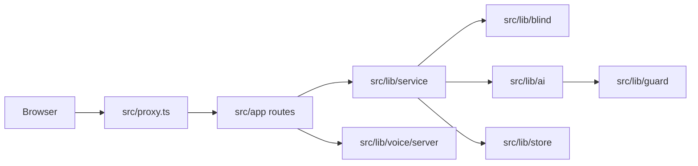

# Architecture

WorkProof is one Next.js 16 app. Pages and the JSON API live in `src/app`. All rules live in `src/lib`, so the API routes stay thin: each one reads its body with a zod schema (`src/lib/http/schemas.ts`), calls one service function and returns JSON or `{ "error": string }` (`src/lib/http/respond.ts`).

## One proof, from submission to meeting

1. **Task.** A company's sentence goes to `POST /api/challenges/draft`. The task designer (`src/lib/ai`) returns a draft with 3 to 5 core skills and a review guide; each wish is kept as a core skill, set aside with its reason, or read as a fact about the job (a work language, a language level, a licence; `src/lib/guard/job-facts.ts`). A person sets the places and approves it with `POST /api/challenges`; the server checks the draft again (`src/lib/guard/check-draft.ts`), publishes the facts in fixed forms as `requirements` ("Good to know") and rebuilds the need talent sees, so the company's own words are never published (`src/lib/service/challenges.ts`).
2. **Follow-ups.** The person writes or speaks an answer. `POST /api/followups` runs the answer through the blind layer first, then asks the designer for two questions about the person's own choices (`followUpsFor` in `src/lib/service/challenges.ts`). The questions must pass the guard (`checkQuestions` in `src/lib/ai/guarded.ts`).
3. **Submission.** First `POST /api/preview` (`src/lib/service/preview.ts`) runs the same blind layer over the unsent text and stores nothing, so the person sees what the company will read and can go back before Send. Then `POST /api/submissions` (`src/lib/service/submissions.ts`) refuses work for an event task that already has all its places (5 to 30 per task, default 12, `src/lib/domain/places.ts`), stores the original in a `Submission` and builds the proof. A picture is accepted only with the person's confirmation that it shows only the work:
   - `blindWork` (`src/lib/blind/blind-work.ts`) redacts the answer, every question and answer pair, and a picture's description.
   - `atAGlance` (`src/lib/blind/glance.ts`) counts points, words and code. It never reads what the work says.
   - `toOwnProof` (`src/lib/blind/project.ts`) builds the author's view with a neutral label such as "Proof K7" and the hidden details by category.
   - Two audit entries record that details were hidden and the shape was counted. Consent to Second look is recorded when given.
4. **Review.** `GET /api/companies/[id]/queue` (`src/lib/service/views/queue.ts`) returns the company's own blind proofs and its Second look proofs, each sorted by arrival time. Every proof goes through `toBlindProof`, which drops the count and the categories of hidden details: how much was hidden would hint at a background. Every reviewer reads the same fixed line instead, "Personal details are removed by rules before review. Some can remain." (`REVIEWER_HIDDEN_LINE` in `src/lib/domain/guardrails.ts`). A reviewer can report a picture as possibly identifying (`POST /api/proofs/[proofId]/picture/report`); it is then removed for every reader.
5. **Decision.** `POST /api/decisions` (`src/lib/service/decisions.ts`) needs a reviewer name, feedback (`src/lib/domain/decision-rules.ts`) and the reviewer's points: one whole number from 1 to 5 for each core skill of the task (`src/lib/domain/scoring.ts`). The server stores the total out of 10, the average points × 2. A reviewer can score only and decide later (`hold`); `POST /api/decisions/[id]/decide` turns a hold into Meet or Not now, and the scores and reason stay. `GET /api/companies/[id]/tasks/[taskId]/top` lists a task's scored proofs, highest total first, ties by arrival (`src/lib/service/views/leaderboard.ts`). The name must be one of the company's registered reviewers (`Company.reviewers`, `src/lib/service/reviewers.ts`): any other name gets 403 until the person adds themselves with `POST /api/companies/[id]/reviewers`, an explicit step that is logged; a name that reads as software ("AI bot") gets 400 at both routes. Meet creates a meeting with a slot; Not now from the owner may open Second look. Each decision is an audit entry with `actor: "human"`, and the city counts automated decisions over the stored decisions and the log (`src/lib/service/views/automated.ts`).
6. **Second look.** `src/lib/matching/second-look.ts` releases a proof to other employers only when the person allowed it, no owner chose Meet, and an owner said Not now or 48 hours passed without an answer. The other task must share at least 2 core skills. It compares tasks, never people. The person can withdraw consent (`src/lib/service/sharing.ts`): employers that have not answered can no longer read the proof; an employer that already answered keeps its decision and its own feedback, but no longer sees the proof text unless a meeting was accepted.
7. **Meeting.** Only the author can accept, with their private key (`acceptMeeting` in `src/lib/service/meetings.ts`). After that, the queue shows that company the name and contact, never the talent id. Both sides confirm the meeting took place; the status becomes `met` only when both have.
8. **City.** `GET /api/city` (`src/lib/service/views/city.ts`, `src/lib/service/views/insights.ts`) counts proofs, answers, answers still owed per employer, meetings, tasks and the proofs handed in for them per skill, arrivals per day and the process safeguards. No talent id, name or contact. The organiser can draft a reminder to an employer that owes answers (`GET /api/city/actions` returns what a reminder needs; nothing is sent) and export the meeting list with `GET /api/city/meetings.csv`, which carries slots and labels, never names (`src/lib/service/city-actions.ts`).
9. **Table.** A demonstration of consent and the name reveal. The big screen (`/table`) lists practice proofs from phones at the table as labels and tasks, never free text (`src/lib/service/table.ts`), so the host does not see the work there. The host invites one with a two-sentence message (`POST /api/table/proofs/[proofId]/invite`); the phone reads it and accepts or declines (`.../accept`, `.../decline`). Only after an accept does the name appear on the big screen.

## The sandbox model

- `src/proxy.ts` gives every visitor an httpOnly cookie `workproof_sandbox` with a random id on the first page visit (`src/lib/store/cookie.ts`). API requests never get one, so a loop of cookie-less API calls cannot create sandboxes.
- `getStore()` in `src/lib/store/index.ts` resolves the store on every call: the caller's sandbox inside a request with the cookie; inside a request without one, the shared default store read-only (a change answers 401 "Open the site first."); outside a request, the default store. Services never know about sandboxes.
- The registry (`src/lib/store/sandbox.ts`) keeps at most 2000 sandboxes in memory and drops the least recently used, but never one used in the last 30 minutes: when all are that recent, a newcomer reads the default store instead. A sandbox is replaced after 12 hours. One address can create 20 sandboxes per 10 minutes (`src/lib/store/creation-limit.ts`). Each new sandbox is a fresh copy of the demo event at the story stage `invited`.
- Each sandbox has a 6-character share code without 0, O, 1 or I. `?table=<code>` on any page sends the visitor through `src/app/api/demo/join/route.ts`, which moves their cookie to that sandbox. This is how a phone and the booth screen share one event.
- The person's private key is never in a URL: a header (`x-workproof-key`) on reads and table answers, the request body on submissions, meeting answers and sharing changes (`src/lib/http/talent-key.ts`).
- Without a cookie (unit tests, evals, scripts) the default store is used. It is saved to `.data/store.json` unless `PROOF_DATA_FILE=off`; sandboxes are never saved.
- Reset and story requests rebuild only the caller's sandbox and have their own rate limit (`src/lib/http/limits.ts`).

## The blind projection

- Rules, not a model. `redact` (`src/lib/blind/redact.ts`) runs, in order: contacts, the author's own name in many spellings, event company names, schools, places and employers (`src/lib/blind/background.ts`, `src/lib/blind/lexicon.ts`), then personal details such as age, residence status, origin, belief, health and family (`src/lib/blind/personal.ts`).
- Every match becomes one neutral token, `[hidden]`, so the context does not tell what was there.
- The reviewer type `BlindProof` has no identity fields (`src/lib/domain/types.ts`). `toBlindProof` copies named fields only, including nested ones, so a new field on a stored proof cannot leak by accident.
- `src/lib/blind/redos.test.ts` keeps the patterns safe from slow inputs; text is cut to the answer limit before the rules run.

## The guard

- `findJudgement` (`src/lib/guard/no-judgement.ts`) finds scores, ranks and verdicts in any text, in English, Finnish and Swedish, on a normalised copy (`src/lib/guard/normalise.ts`), so lookalike letters, zero-width characters and spaced-out words do not slip through.
- `protectedNames` (`src/lib/guard/protected.ts`) finds protected attributes such as age, gender, origin, native language, religion, health and "culture fit".
- `guarded` (`src/lib/ai/guarded.ts`) wraps every designer: a draft or question that fails the checks is rejected, and the backup designer answers instead.
- The server repeats the draft checks when a person publishes a card, so an edited card cannot bring judging text back.

## The provider layer

- `resolveProvider` (`src/lib/ai/provider/select.ts`) reads the environment once: `AI_PROVIDER` forces a designer; otherwise Claude if `ANTHROPIC_API_KEY` is set, then Gemini, then the scripted designer.
- `modelDesigner` (`src/lib/ai/provider/model-designer.ts`) holds the prompts, the JSON schema and the draft building for both APIs. Each adapter (`src/lib/ai/claude/designer.ts`, `src/lib/ai/gemini/designer.ts`) only sends the request.
- `postJson` (`src/lib/ai/provider/http.ts`) allows 20 seconds per attempt and retries once on 429 or 5xx. Errors carry the service, the status and the API's short reason, never the key or the text.
- A circuit breaker (`src/lib/ai/provider/breaker.ts`) pauses a failing provider for 5 minutes after an auth, quota, timeout or service failure, so drafts do not wait for the same failure. A reply the guard rejected does not open the pause.
- On any failure the scripted designer answers (`createDesigner` in `src/lib/ai/index.ts`). `GET /api/ai/status` reports which designer is live, never the key.

## Voice

- Voice is planned, not live. Every flow is typed; the interface shows a quiet "Voice coming soon" marker (`src/components/voice/voice-soon.tsx`) and asks for no microphone.
- The planned pieces stay in the code, unused by any screen: `src/lib/voice/resolve.ts` would pick ElevenLabs through the server when a key is set, the browser's Web Speech API otherwise.
- `POST /api/voice/transcribe` passes the audio once to ElevenLabs and returns text (`src/lib/voice/server/elevenlabs.ts`). Nothing is written to the store. No screen calls it.

## The story stages

`src/lib/seed/story.ts` and `src/lib/seed/index.ts` rebuild a sandbox deterministically, with times relative to now, at one of four stages. `POST /api/demo/story` sets a stage; the guided tour does this itself (`src/components/tour/steps.ts`).

| Stage | State |
|---|---|
| `before` | Mikko, a designer, has two earlier proofs: a feature-list cut that Tuulos Robotics scored and answered "not now" with a reason, and a chart reading for Saarnivo Grid that waits for an answer. His work from two earlier events shows in My work. The Halla Supply challenge "Make our order form easier to use" is open. |
| `sent` | His Halla Supply work (label K7) waits in Halla's queue, with his name, a past client, where he lives and his school hidden. |
| `invited` | Laura Niemi at Halla Supply scored each skill (5, 5, 4, 4), so the total is 9 of 10, wrote why and invited him; Mikko has an open invitation. The default for free exploring. |
| `met` | Mikko said yes; Halla Supply sees his name. Both sides confirmed the talk, and Halla agreed a follow-up. |
